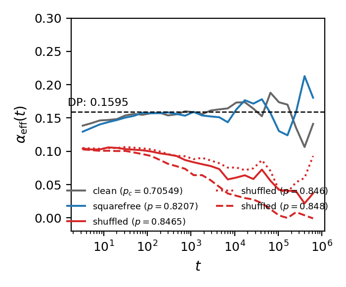

# Arithmetic rigidity protects directed percolation

**Paper:** [`paper/squarefree_dp.pdf`](paper/squarefree_dp.pdf)

> **AI disclosure:** this work was heavily AI assisted. The idea search, both simulation
> engines, the analysis, the blind replication protocol, and the manuscript were produced by
> Anthropic's Claude models (Claude Fable 5 and Claude Opus 4.8) under human direction.
> Details in [`PROVENANCE.md`](PROVENANCE.md).

Take a one dimensional spreading process (directed percolation, the standard model for
epidemics, forest fires, and absorbing state transitions) and weaken 39.2% of its sites.
Place the weak sites at the positions of the non squarefree integers (multiples of 4, 9, 25,
and so on) and the famous clean critical behavior survives untouched: a stable power law decay
with exponent 0.155(15) over five decades of time, matching the textbook value 0.1595. Take
the exact same weak sites and shuffle their positions randomly and the transition is
destroyed: the effective exponent never stabilizes and drifts toward zero, the signature of
disorder dominated, activated dynamics. The two systems differ only in the *arrangement* of
identical disorder. The integers protect the physics; noise does not.



*Local decay exponent at criticality. Clean system (gray) and squarefree disorder (blue) sit
on the directed percolation value for six decades. The same disorder shuffled (reds, three
couplings spanning the critical region) starts at half that value and sags toward zero.*

The mechanism is number theoretic rigidity: runs of consecutive non squarefree integers are
sharply capped (longest run 8 in windows of a million, versus 19 with an exponential tail
after shuffling), so the rare weak regions that normally destabilize disordered transitions
simply do not exist. The squarefree sequence also has anomalously small density fluctuations
(wandering exponent 1/4 versus 1/2 for noise), measured directly here. Standard relevance
criteria (Harris, Luck) would naively classify both disorders as relevant; the data says the
arithmetic one is protected at every accessible scale. Which reading of that tension is
correct is, we think, a genuinely open theoretical question.

## What is in this repository

| path | contents |
|---|---|
| `paper/` | LaTeX source, figure scripts, compiled PDF |
| `src/` | the two simulation engines: `dp.c` (C, xoshiro256++) and `s1_dp.py` (NumPy), cross validated against each other; scan/analysis drivers |
| `data/deep1/` | all 34 production runs (density vs time, L = 2^20, t up to 10^6) |
| `blind/SPEC.md` | the context free task specification given to the blind replication agents |
| `blind/agent1/`, `blind/agent2/` | the two independent blind implementations: their own code, raw data, and reports, included verbatim |

## The blind replication protocol

Effective exponent analyses are easy to fool yourself with. So the headline numbers were
replicated by two additional implementations written from scratch by AI agents that received
only `blind/SPEC.md`: the model definition and a single directive (find the critical points,
classify the decay as stable power law versus drifting). No hypothesis, no expected values, no
contact with each other, their own RNGs, offsets, and analysis pipelines. Both independently
reproduced the critical points (0.8207 and 0.8455) and the stable versus drifting dichotomy.
Their unedited code, data, and reports are in `blind/`.

## Reproduce it

Everything below runs on a laptop (this was all produced on an 8 core M2 Mac mini).

```
cc -O3 -march=native -o dp src/dp.c -lm

# squarefree disorder at its critical point: mode 1, p=0.8207
./dp 1 0.8207 0.6 1048576 1000000 1000003 42 70 > sf.dat

# the same disorder shuffled, at its critical point: mode 2, p=0.8465
./dp 2 0.8465 0.6 1048576 1000000 1000003 42 70 > sh.dat

# clean reference: mode 0
./dp 0 0.7054852 0.6 1048576 1000000 1000003 42 70 > clean.dat
```

Each run takes roughly 30 to 60 minutes and prints density versus time at log spaced points.
Plot the local log log slope: the squarefree and clean curves hold near 0.16; the shuffled
curve starts near 0.10 and decays. Arguments: `mode p c L T offset seed n_outputs`. Figures:
`cd paper && python3.11 make_figs.py` (NumPy and matplotlib required).

## Honest limitations

Simulations reach t = 10^6 on lattices of 10^6 sites. That cannot exclude a crossover of the
squarefree system away from directed percolation at much larger times; the claim defended
here is the equal time, equal statistics contrast between the two arrangements, not infinite
time universality. One weakness factor (c = 0.6) and one observable (density decay) were
studied. Spreading from seed exponents, the c dependence, k free integers, and the Möbius
function are natural next experiments. Scrutiny is welcome, particularly from the aperiodic
criticality and strong disorder communities; if you find an error, please open an issue.

## Provenance

This work was produced in a single day, largely autonomously, by Anthropic's Claude models
(Claude Fable 5 and Claude Opus 4.8) under human direction, including the idea search, both engines, the blind
replication protocol, and the manuscript. The protocol exists precisely because AI assisted
research needs structural protection against self confirmation. See `PROVENANCE.md` for the
full audit trail description.

## Contact and license

Davis Brief, davis@team8.co. Code and data are MIT licensed (see `LICENSE`).
If you use this, a citation of the paper PDF in this repository is appreciated.
